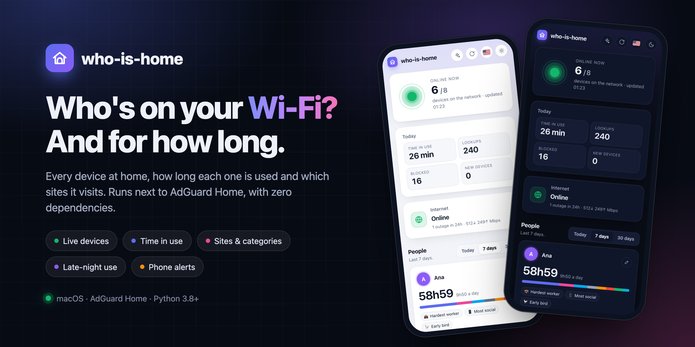
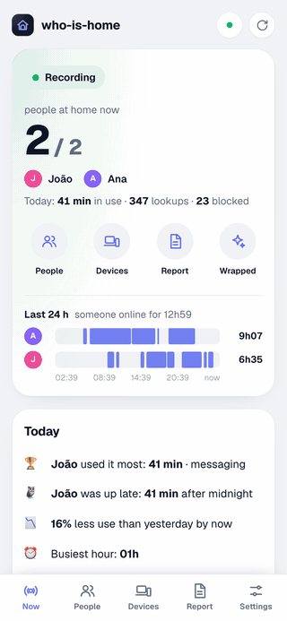
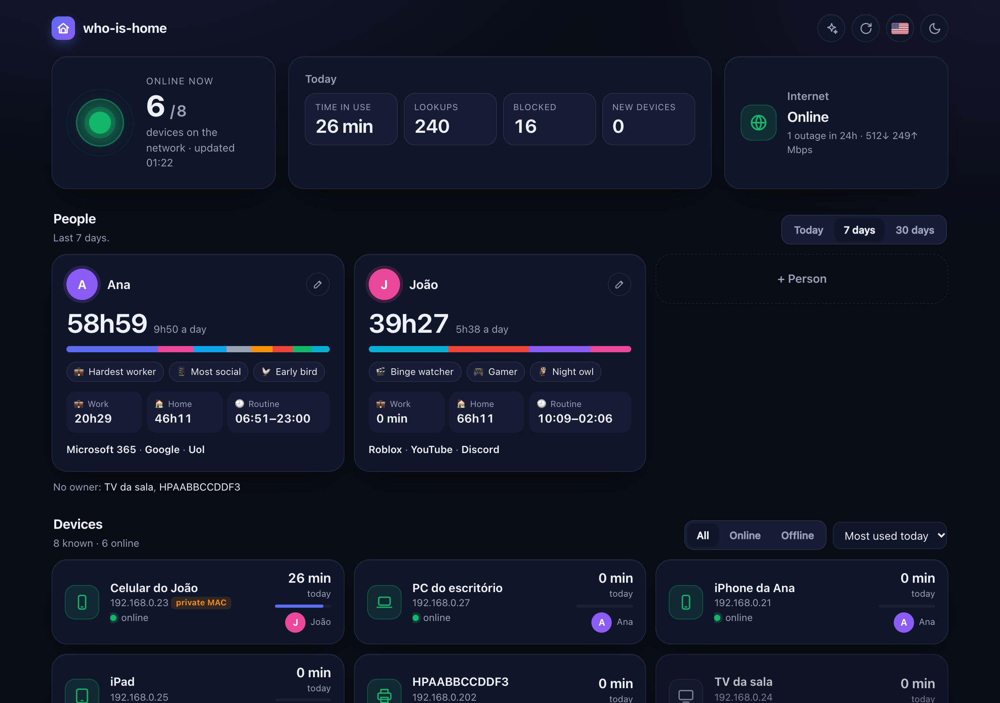
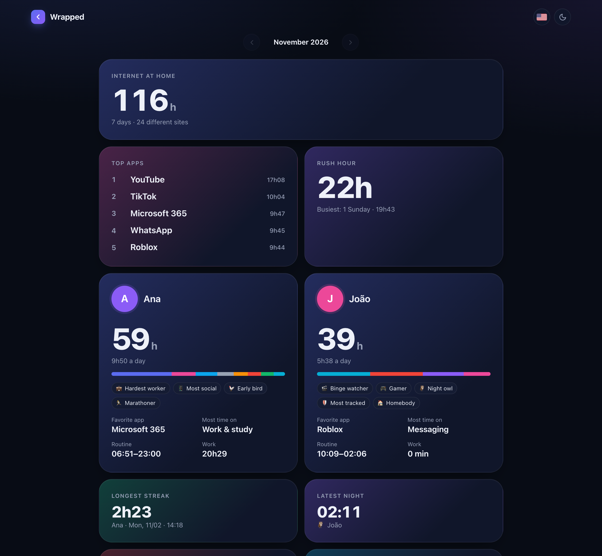

<p align="center">
  
</p>

<p align="center">
  
  
  
  
</p>

<p align="center">
  🇺🇸 <b>English</b> · 🇧🇷 <a href="README_pt-BR.md">Português</a> · 🇨🇳 <a href="README_zh-CN.md">中文</a>
</p>

**who-is-home** shows every device on your home network, how long each one is used and which sites it visits. It runs next to [AdGuard Home](https://github.com/AdguardTeam/AdGuardHome) on an always-on computer, and pairs with [down-again](https://github.com/Bruno-Furtado/down-again).

## Features

- 🟢 **Live devices**: who's on now, with real names and the last time each was seen.
- ⏱️ **Time in use**: per device, per hour and per category (social, video, games, work…).
- 🌐 **Sites**: the most visited and the blocked ones, per device.
- 👥 **People**: who uses it most, who works most, routines and fun titles (night owl, early bird…).
- 🎁 **Wrapped**: the month in review, with top apps, records and one card per person.
- 🌙 **Late-night use** and a day-by-day timeline for each device.
- 🔔 **Phone alerts**: new device on the network and a weekly summary.
- 🪶 **Zero dependencies**: just Python. The dashboard works even with the internet down.

## Screenshots

<table>
  <tr>
    <td width="34%" valign="top"></td>
    <td valign="top">
      <br><br>
      
    </td>
  </tr>
</table>

<sub>Screenshots use simulated data.</sub>

## Quick start

Needs AdGuard Home running on the same computer and set as the network DNS.

```bash
git clone https://github.com/Bruno-Furtado/who-is-home.git
cd who-is-home
python3 who_is_home.py setup     # AdGuard login and phone alerts
python3 who_is_home.py install   # runs in the background and starts with the computer
```

Open `http://<computer-name>.local:8080` on your phone.

The dashboard has no login: keep it on a trusted network and never expose the port to the internet. See [SECURITY.md](SECURITY.md).

---

<div align="center">
  <sub>Made with ♥ in Curitiba 🌲 ☔️</sub>
</div>
