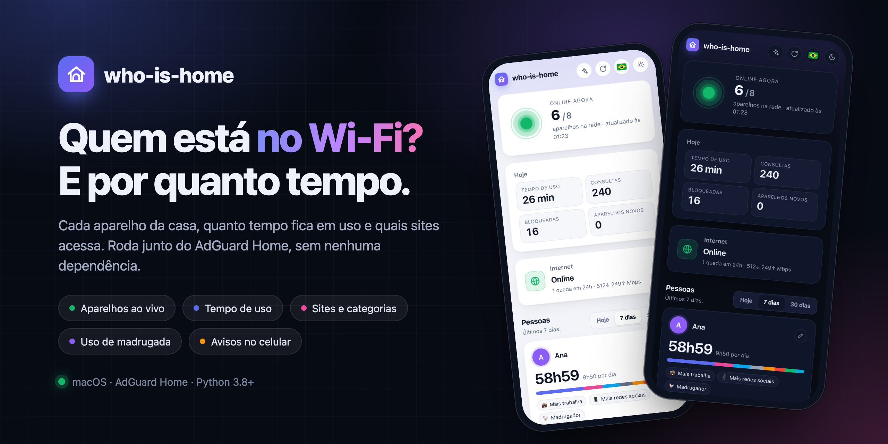
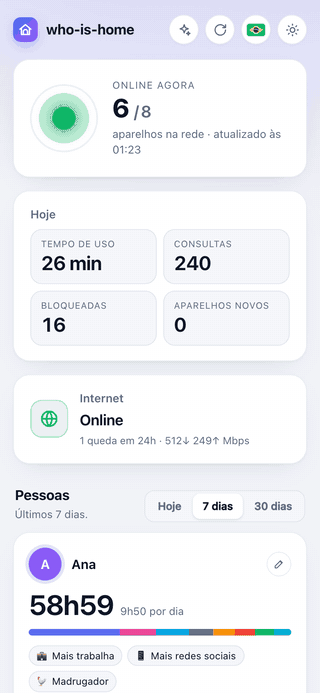
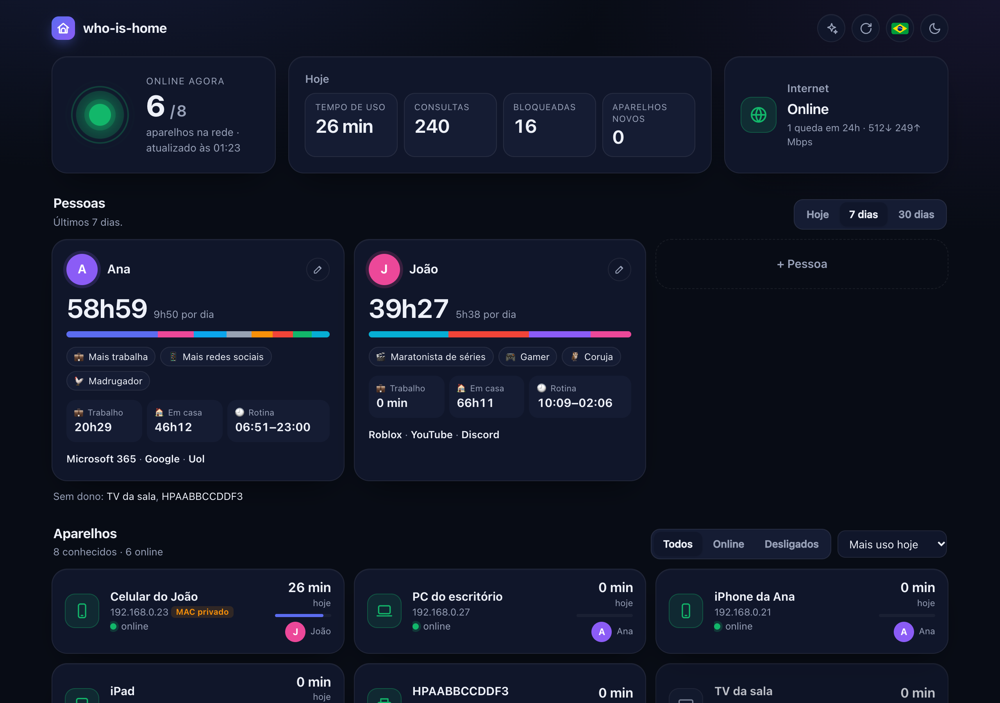
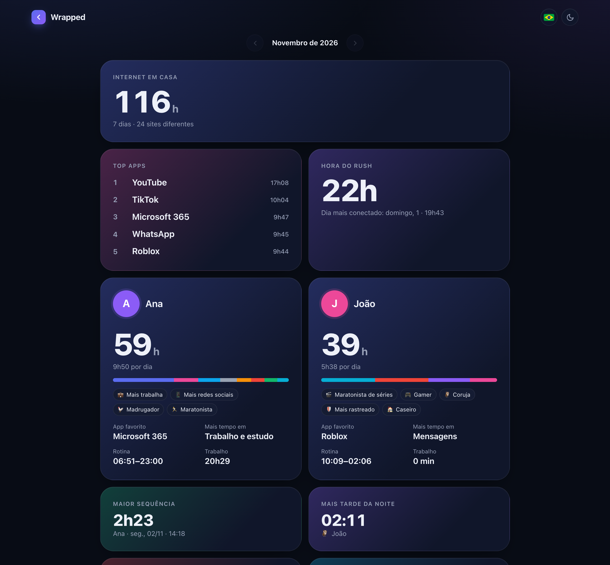

<p align="center">
  
</p>

<p align="center">
  
  
  
  
</p>

<p align="center">
  🇺🇸 <a href="README.md">English</a> · 🇧🇷 <b>Português</b> · 🇨🇳 <a href="README_zh-CN.md">中文</a>
</p>

O **who-is-home** mostra cada aparelho da rede de casa, quanto tempo cada um fica em uso e quais sites acessa. Roda junto do [AdGuard Home](https://github.com/AdguardTeam/AdGuardHome) num computador ligado 24h e combina com o [down-again](https://github.com/Bruno-Furtado/down-again).

## Recursos

- 🟢 **Aparelhos ao vivo**: quem está ligado agora, com nomes de verdade e quando cada um foi visto.
- ⏱️ **Tempo de uso**: por aparelho, por hora e por categoria (redes sociais, vídeo, jogos, trabalho…).
- 🌐 **Sites**: os mais acessados e os bloqueados, por aparelho.
- 👥 **Pessoas**: quem mais usa, quem mais trabalha, rotina e títulos divertidos (coruja, madrugador…).
- 🎁 **Wrapped**: a retrospectiva do mês, com top apps, recordes e um cartão por pessoa.
- 🌙 **Uso de madrugada** e linha do tempo dia a dia de cada aparelho.
- 🔔 **Avisos no celular**: aparelho novo na rede e resumo da semana.
- 🪶 **Zero dependências**: só Python. O painel funciona mesmo com a internet fora.

## Telas

<table>
  <tr>
    <td width="34%" valign="top"></td>
    <td valign="top">
      <br><br>
      
    </td>
  </tr>
</table>

<sub>As telas usam dados simulados.</sub>

## Começo rápido

Precisa do AdGuard Home rodando no mesmo computador e configurado como DNS da rede.

```bash
git clone https://github.com/Bruno-Furtado/who-is-home.git
cd who-is-home
python3 who_is_home.py setup     # login do AdGuard e avisos no celular
python3 who_is_home.py install   # roda em segundo plano e inicia com o computador
```

Abra `http://<nome-do-computador>.local:8080` no celular.

O painel não tem login: use numa rede de confiança e nunca exponha a porta para a internet. Veja o [SECURITY.md](SECURITY.md).

---

<div align="center">
  <sub>Feito com ♥ em Curitiba 🌲 ☔️</sub>
</div>
