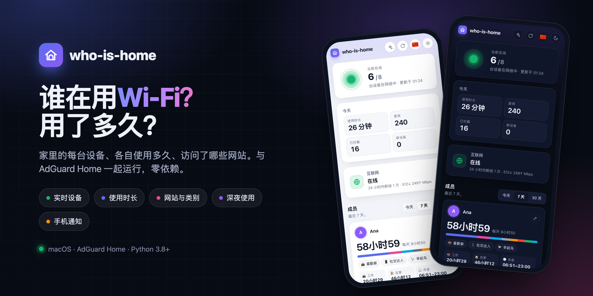
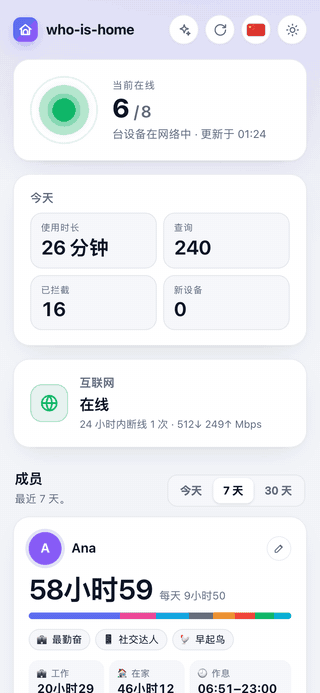
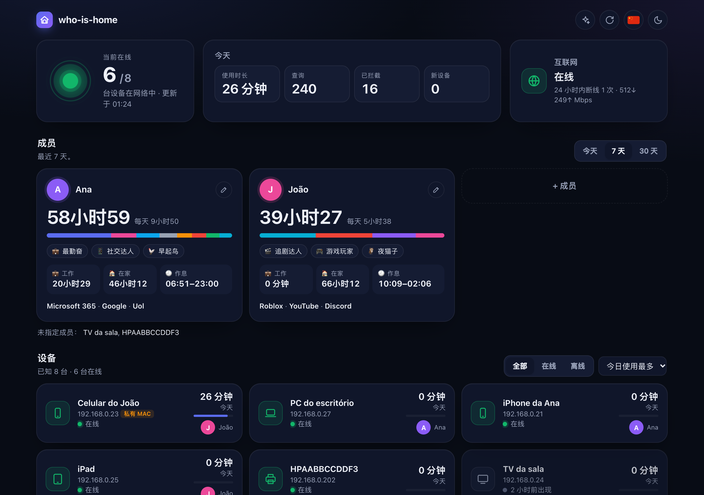
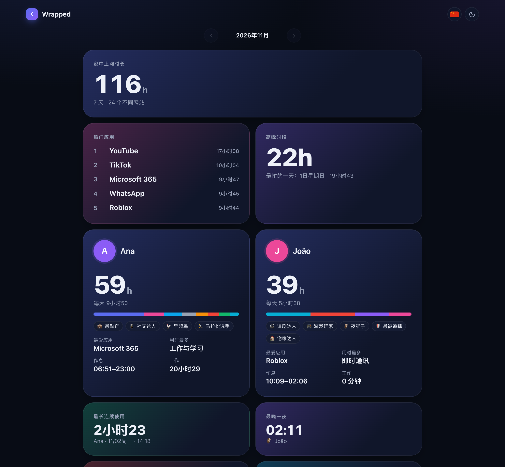

<p align="center">
  
</p>

<p align="center">
  
  
  
  
</p>

<p align="center">
  🇺🇸 <a href="README.md">English</a> · 🇧🇷 <a href="README_pt-BR.md">Português</a> · 🇨🇳 <b>中文</b>
</p>

**who-is-home** 显示家庭网络中的每台设备、各自使用多久以及访问了哪些网站。它与 [AdGuard Home](https://github.com/AdguardTeam/AdGuardHome) 一起运行在长期开机的电脑上，并可与 [down-again](https://github.com/Bruno-Furtado/down-again) 搭配使用。

## 功能

- 🟢 **实时设备**：当前谁在线，显示真实名称和最后出现时间。
- ⏱️ **使用时长**：按设备、按小时、按类别（社交、视频、游戏、工作……）。
- 🌐 **网站**：每台设备访问最多和被拦截的网站。
- 👥 **成员**：谁用得最多、谁最勤奋、作息和有趣的称号（夜猫子、早起鸟……）。
- 🎁 **月度回顾**：热门应用、纪录，以及每位成员的卡片。
- 🌙 **深夜使用**，以及每台设备的每日时间线。
- 🔔 **手机通知**：新设备加入和每周总结。
- 🪶 **零依赖**：只需 Python。即使外网中断，面板也能打开。

## 截图

<table>
  <tr>
    <td width="34%" valign="top"></td>
    <td valign="top">
      <br><br>
      
    </td>
  </tr>
</table>

<sub>截图使用模拟数据。</sub>

## 快速开始

需要 AdGuard Home 在同一台电脑上运行，并已设为网络的 DNS。

```bash
git clone https://github.com/Bruno-Furtado/who-is-home.git
cd who-is-home
python3 who_is_home.py setup     # AdGuard 登录信息和手机通知
python3 who_is_home.py install   # 在后台运行，并随电脑启动
```

在手机上打开 `http://<电脑名称>.local:8080`。

面板没有登录：请在可信网络中使用，切勿将端口暴露到互联网。参见 [SECURITY.md](SECURITY.md)。

---

<div align="center">
  <sub>在库里蒂巴用 ♥ 制作 🌲 ☔️</sub>
</div>
